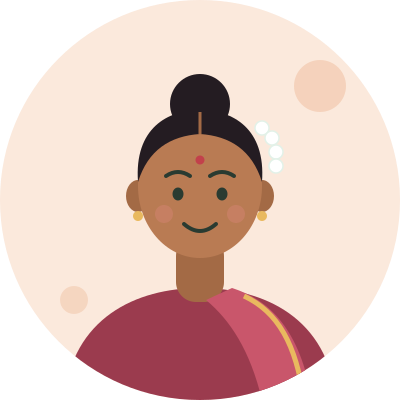
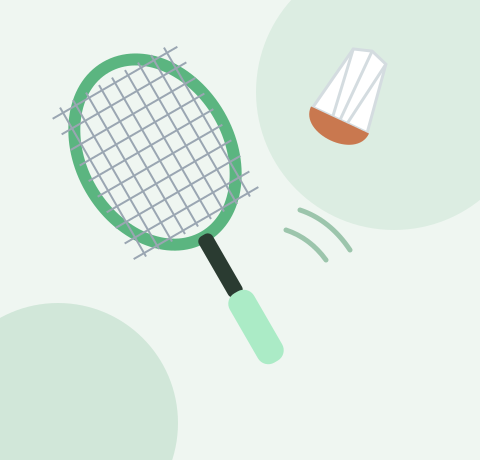

# Project Guide — Profile Website + CI/CD Pipeline

**For:** Mahalakshmi Vetrivel · **Repository name used in this guide:** `profile-website` · **GitHub username:** `Mahalakshmi-Vetrivel`

This guide explains, in plain English, what was built, how it works, how to change it, and exactly what *you* need to do on GitHub to finish and submit the assignment. Read Parts A–C once, then follow Part D step by step.

> **Words used in this guide**
> - **Repository (repo):** a project folder tracked by Git and stored on GitHub.
> - **Branch:** a separate line of work inside the repo (e.g. `feature/hero-section`).
> - **Commit:** a saved snapshot of your changes with a message.
> - **Pull request (PR):** a request on GitHub to merge one branch into another, where others can review.
> - **Workflow:** an automated job (a `.yml` file) that GitHub Actions runs for you.

---

## Contents

- **Part A — Understand the project:** 1 What this is · 2 What the website contains · 3 Technologies · 4 Folder structure · 5 Every file explained · 6 How HTML, CSS and JS work together · 7 The theme system
- **Part B — Customise it:** 8 Replace images · 9 Replace text · 10 Family cards · 11 Interest cards · 12 Gallery images · 13 Social links · 13a Typing tagline · 13b Numbers strip · 13c Project cards · 13d Pipeline steps · 13e Effects
- **Part C — Run and test locally:** 14 Open the site · 15 Test mobile layouts · 16 Test the theme switch · 17 Test the lightbox and other interactions
- **Part D — GitHub, step by step:** 18 Before you start · 19 Create the repository · 20 The branch plan · 21 Phase 1 setup · 22 Feature, CI and theme branches · 23 Pull requests and reviews · 24 GitHub Pages · 25 Branch protection · 26 Slack secret · 27 Check Actions runs · 28 Lighthouse reports
- **Part E — Help and submission:** 29 Troubleshooting · 30 What you must complete before submission

---

# Part A — Understand the project

## 1. What this project is

You are building a one-page personal website and, more importantly, practising the **Git + DevOps workflow** around it:

- Every change goes through a **branch → commit → push → pull request → review → merge** cycle.
- **GitHub Actions** automatically checks your code (HTML/CSS validation, quality checks), **deploys** the site to GitHub Pages, **audits** it with Lighthouse, and **notifies** you of the result.
- The whole visual theme lives in **one file** (`css/theme.css`). Changing that one file, committing and pushing re-themes the live site automatically. That is the core lesson.

## 2. What the website contains

| Section | id | Content (already filled with your details) |
|---|---|---|
| Navigation | — | Fixed top bar; collapses to a ☰ hamburger menu on mobile; theme toggle button (the new theme grows as a circle from the button); a thin progress bar under the bar fills as you scroll; on desktop (≥ 1024px) a column of section dots on the right edge |
| Hero | `#hero` | Your name, a **typing tagline** (ECE Graduate → Graduate Trainee at Psiog → Data & Web Enthusiast), intro line, illustrated avatar, "Explore My Journey →" button, a signal-wave line (a nod to your EEG project). With a mouse, a soft glow follows the pointer |
| Professional Journey | `#journey` | **"By the numbers"** strip (8.10 CGPA, 3 internships, 2 projects, 5 workflows) that counts up when it scrolls into view; timeline: HSC → B.E. ECE → 3 internships → Graduate Trainee at Psiog, with "Show more" on longer items; **project spotlight**: Micro Sleep Detection System and Data Analysis Dashboard, each with tech chips and a "How it works" flow |
| Personal Likings | `#interests` | 5 cards: Music, Movies & Series, Food, Travel\*, Data & Electronics. On desktop the last row of 2 is centred. With a mouse, cards tilt gently towards the pointer |
| Family | `#family` | Family illustration banner + flip cards for Amma, Appa and your brother, in a warm colour palette |
| Hobbies & Passions | `#hobbies` | 6-tile masonry gallery (cooking, music and badminton, two tiles each). Click a tile → lightbox with Previous/Next, Esc to close |
| Footer | `#footer` | **"How this site is built"**: the 5-step CI/CD pipeline (Push → Validate → Deploy → Lighthouse → Notify) with a link to your Actions tab; then LinkedIn, GitHub, email, "Built with HTML, CSS & JS \| Deployed via GitHub Actions", © year (automatic), back-to-top button |

\* **Travel** contains **sample text** because you didn't share it yet. Replace it (Section 11) or delete the card before submitting.

Every animation (typing, count-up, glow, tilt, theme circle, scroll reveal) is switched off for visitors whose device asks for **reduced motion**; they see the finished, static content instead.

## 3. Technologies and why

| Technology | Used for | Why |
|---|---|---|
| HTML5 | Page structure (`header`, `nav`, `main`, `section`, `article`, `footer`) | Semantic tags help screen readers, SEO and the evaluation criteria |
| CSS3 | Layout (Grid, Flexbox, columns), variables, animations, transitions | Required; CSS variables power the one-file theme |
| JavaScript (ES6+) | Menu, theme toggle, Show more, scroll reveal, flip cards, lightbox, year, progress bar, section dots, typing tagline, count-up, glow, tilt | Required; no jQuery or libraries |
| View Transitions API | The circle animation when the theme changes | Built into modern browsers (no library); browsers without it simply switch instantly |
| SVG illustrations | All images | Tiny files, sharp on every screen, no real photos needed |
| Git + GitHub | Version control, branches, pull requests, reviews | Core of the assignment |
| GitHub Actions | Validation, deployment, audits, notifications | The CI/CD part of the assignment |
| GitHub Pages | Free hosting of the live site | Required deployment target |

**Not used (prohibited):** React, Angular, Vue, Bootstrap, Tailwind, Sass, LESS, jQuery, TypeScript, npm packages in the site. The only npm usage is *inside GitHub Actions* to install the linting tools (HTMLHint, CSSLint, csstree-validator), exactly as the assignment's Workflow 1 does. Nothing is installed on your laptop.

## 4. Folder structure

```
profile-website/
├── index.html                  ← the whole single-page site
├── css/
│   ├── theme.css               ← ALL design variables (the one theme file)
│   └── style.css               ← all layout & component styles (var() only)
├── js/
│   └── main.js                 ← all interactions
├── images/
│   ├── hero/                   ← profile-avatar.svg, favicon.svg
│   ├── journey/                ← 6 timeline icons, 2 project icons, 8 "how it works" step icons
│   ├── interests/              ← 5 interest illustrations
│   ├── family/                 ← group banner + 4 avatars
│   └── hobbies/                ← 6 gallery illustrations
├── .github/
│   ├── workflows/
│   │   ├── validate.yml        ← Workflow 1: HTML & CSS validation
│   │   ├── deploy.yml          ← Workflow 2: deploy to GitHub Pages
│   │   ├── pr-checks.yml       ← Workflow 3: PR quality gates
│   │   ├── lighthouse.yml      ← Workflow 4: Lighthouse audit
│   │   └── notify.yml          ← Workflow 5: deployment notification
│   └── pull_request_template.md← pre-fills every PR description
├── .htmlhintrc                 ← HTMLHint rules
├── .csslintrc                  ← CSSLint rules
├── .gitignore                  ← files Git should ignore
├── README.md                   ← project summary shown on GitHub
└── PROJECT_GUIDE.md            ← this guide
```

## 5. Every file explained

| File | Purpose |
|---|---|
| `index.html` | All six sections, the navigation, the section dots and the lightbox. Comments marked `EDIT:` show where to change content; `SAMPLE CONTENT` marks text you should replace. |
| `css/theme.css` | Light theme (`:root`), dark theme (`[data-theme="dark"]`) and the warm family sub-palette (`.section--family`). Colours, fonts, sizes, spacing, radius, shadows, speeds (including the typing, count-up and theme-circle timings), grid column templates. |
| `css/style.css` | How things are laid out and how they look, using only `var(--...)` from theme.css. Mobile-first with breakpoints at 640px, 900px, 1024px and 1280px. Sections 1–13 are the core site; 14 = polish effects, 15 = typing tagline + numbers strip, 16 = project spotlight, 17 = pipeline. |
| `js/main.js` | Applies the saved theme before the page appears, then sets up: theme toggle (with the circle animation), hamburger menu, smooth scrolling, header shadow, scroll progress bar, active nav link and section dot, back-to-top, Show more/less, scroll reveal (IntersectionObserver), flip cards, lightbox, copyright year, hero glow, card tilt, typing tagline, count-up. Speeds are read from theme.css. |
| `images/**.svg` | Original illustrations (no real people, no copyrighted art). See Section 8 for each file. |
| `.github/workflows/*.yml` | The five automations (Part D). |
| `.github/pull_request_template.md` | GitHub automatically fills new PR descriptions with this checklist, so PRs are never empty. |
| `.htmlhintrc` | The 8 rules from the assignment plus `title-require`, `spec-char-escape`, `attr-no-duplication`, `inline-style-disabled`. |
| `.csslintrc` | Turns off CSSLint rules that misunderstand modern CSS (it was last updated in 2016), and turns real problems (empty rules, duplicate properties, ids in selectors, `outline: none`…) into errors. |
| `.gitignore` | Stops OS/editor junk (`Thumbs.db`, `.vscode/`) and tool output from being committed. |

## 6. How HTML, CSS and JavaScript work together

1. The browser reads **`index.html`** top to bottom. In `<head>` it loads `theme.css`, then `style.css`, then `main.js`.
2. **`theme.css`** defines variables, e.g. `--color-primary: #5b4b9a;`.
3. **`style.css`** uses them, e.g. `.btn--primary { background: var(--color-primary); }`.
4. **`main.js`** runs immediately and, if you previously chose dark mode, adds `data-theme="dark"` to `<html>` *before* the page is drawn (so it never flashes white). When the page has finished loading, it attaches all the click/scroll behaviour.
5. HTML elements are connected to CSS and JS through **class names** (e.g. `class="timeline__toggle"`) and **ARIA attributes** (e.g. `aria-expanded="false"`), which also tell screen readers what is going on.

Class names follow the BEM pattern: `block__element--modifier` (e.g. `hero__title`, `btn--primary`). This keeps styles predictable.

## 7. The theme system (the most important concept)

- Every colour, font, size, spacing value, radius, shadow and speed is a variable in **`css/theme.css`**.
- `style.css` never contains a hard-coded colour or font; it only says `var(--color-...)`.
- **Light theme** = the values in `:root { ... }` (the default).
- **Dark theme** = the same variable names with new values inside `[data-theme="dark"] { ... }`. The toggle button simply adds or removes `data-theme="dark"` on `<html>`, and every `var()` updates at once.
- **Family warm palette** = `.section--family { ... }` re-defines a few variables just inside that section (a "section-scoped override", as the assignment asks).
- **Toggle visibility is also a theme setting:** `--theme-toggle-display`. In the first version of the site (before dark mode exists) it is `none`, so no useless button is shown. The dark-mode branch changes it to `inline-flex`. This is why the dark-mode exercise really only changes `theme.css`.
- **Animation speeds and effect sizes are theme settings too:** `--typing-speed`, `--typing-pause`, `--count-duration`, `--transition-speed-theme` (the theme circle), `--tilt-max`, `--glow-radius`, `--color-glow` and so on. main.js reads the timings from theme.css, so even the "feel" of the site changes from that one file.
- **Grid column templates** (`--grid-columns-3`, etc.) also live in theme.css. CSSLint, the tool the assignment requires, cannot understand the CSS Grid `fr` unit, so keeping those values in theme.css lets `style.css` pass CSSLint without giving up CSS Grid.

**Try it:** change `--color-primary: #5b4b9a;` to `--color-primary: #0f766e;` in theme.css, save, refresh. Buttons, headings, links and the timeline all turn teal. Undo it afterwards.

---

# Part B — Customise it

> Use **VS Code** (or Visual Studio) to edit files. Press **Ctrl+F** inside `index.html` and search for `EDIT:` or `SAMPLE CONTENT` to jump to every editable spot.

## 8. Replace the avatar illustrations and other images

All images are local files, so nothing can break because of an external link. To swap one, **replace the file with one of the same name** (easiest) or change the `src` in `index.html`.

| File | Used for | Where in index.html | Shape / recommended size |
|---|---|---|---|
| `images/hero/profile-avatar.svg` | Hero portrait (shown as a circle) | `` | Square, ≥ 800×800 px |
| `images/hero/favicon.svg` | Browser tab icon | `<link rel="icon" ...>` in `<head>` | Square, 64×64 |
| `images/journey/school.svg`, `graduation.svg`, `internship-*.svg` (3), `psiog.svg` | Small timeline icons | each `` | Square, 96×96 |
| `images/journey/project-eeg.svg`, `project-dashboard.svg` | Project spotlight card icons | each `` | Square, 96×96 |
| `images/journey/flow-*.svg` (8 files: eeg, esp32, ml, alert, dataset, clean, kpi, insight) | "How it works" step icons | each `` | Square, 96×96 |
| `images/interests/music.svg`, `movies.svg`, `food.svg`, `travel.svg`, `data-electronics.svg` | Interest card pictures | `<div class="interest-card__media">` | 4:3 landscape, 960×720 |
| `images/family/family-group.svg` | Family banner | `<figure class="family__banner">` | 12:5 wide, 1800×750 |
| `images/family/member-amma.svg`, `member-appa.svg`, `member-brother.svg` | Flip-card avatars (shown as circles) | `` | Square, 400×400 |
| `images/family/member-me.svg` | Spare avatar of you (not used yet) | — | Square |
| `images/hobbies/*.svg` (6 files: cooking, cooking-spices, music-melody, music-evenings, badminton, badminton-court) | Gallery tiles and lightbox | each `<button class="gallery__button">` | Any ratio (the masonry adapts), ~960 px wide |

**If you use a real photo instead of an SVG:**
1. Save it as `.jpg` or `.webp` and compress it (e.g. with squoosh.app) to under ~200 KB.
2. Put it in the right folder, e.g. `images/hero/profile-photo.jpg`.
3. Update the `src` in `index.html` and set `width`/`height` to the photo's real pixel size (this prevents the page jumping while loading).
4. Keep a meaningful `alt` text, e.g. `alt="Portrait of Mahalakshmi smiling"`.

## 9. Replace sample or personal text

| What | Where |
|---|---|
| Browser tab title, description | `<title>` and `<meta name="description">` in `<head>` |
| Status pill ("Graduate Trainee at Psiog") | `<p class="hero__status ...">` |
| Name | `<h1 class="hero__title ...">` (the surname is inside `<span class="hero__title-accent">`) |
| Tagline (and the typing words) | `<span class="hero__tagline-text">` inside `<p class="hero__tagline ...">`. See Section 13a |
| Intro line | `<p class="hero__intro ...">` |
| Skill badges around the avatar | the three `<span class="hero__badge ...">` |
| Section headings and lead lines | each `<h2 class="section__title">` and `<p class="section__lead">` |
| Timeline milestones | each `<li class="timeline__item ...">` |

**Timeline tips:** each item has a `timeline__date`, `timeline__title`, `timeline__org` and `timeline__text`. For a "Show more" part, the hidden `<div class="timeline__more" id="more-XYZ" hidden>` and the button's `aria-controls="more-XYZ"` must use the **same unique id**. To remove Show more from an item, delete both the `timeline__more` div and the button. The internship items currently show "Internship" as the date; replace this with the year(s) when you know them.

## 10. Add, rename or remove family members

Each member is one block:

```html
<div class="flip-card reveal">
  <button class="flip-card__inner" type="button" aria-pressed="false">
    <span class="flip-card__face flip-card__face--front">
      
      <span class="flip-card__relation">Amma</span>
      <span class="flip-card__name">SornaLatha</span>
      <span class="flip-card__hint" aria-hidden="true">Tap to flip</span>
    </span>
    <span class="flip-card__face flip-card__face--back">
      <span class="flip-card__relation">Amma</span>
      <span class="flip-card__quote">A homemaker and the heart of our home...</span>
    </span>
  </button>
</div>
```

- **Rename:** edit the `flip-card__relation`, `flip-card__name` and `flip-card__quote` text.
- **Hide a name:** delete the `<span class="flip-card__name">` line (names are optional in the assignment).
- **Add:** copy a whole block, paste it after the last one, change the image and text. The grid automatically wraps.
- **Remove:** delete the whole `<div class="flip-card reveal"> ... </div>` block.

The avatar `alt=""` is intentionally empty because the relationship and name are already written right below it (screen readers would otherwise read it twice).

## 11. Add or remove interest cards

Each card is one `<article class="interest-card reveal"> ... </article>`. Copy one to add, delete one to remove. Change the image `src` and `alt`, the `<h3>` title, the `<p>` description and the `<li class="chip">` tags. The grid shows 3 columns on desktop, 2 on tablets and 1 on phones automatically. If the last row is not full (e.g. 5 cards = 3 + 2), CSS centres it for you, for any number of cards.

**To do:** replace the **Travel** sample text. Optionally, add your top 5 movies or series as chips in the Movies card (the assignment suggests "Top 5 favorites").

## 12. Add gallery (hobby) images

Each tile is one `<li class="gallery__item reveal">`. The `data-title` and `data-description` attributes are what the lightbox shows:

```html
<li class="gallery__item reveal">
  <button class="gallery__button" type="button" data-title="Badminton" data-description="Longer write-up shown in the lightbox.">
    
    <span class="gallery__caption"><span class="gallery__tag">Badminton</span><span class="gallery__label">Short caption</span></span>
  </button>
</li>
```

Put the image in `images/hobbies/`, copy a block, and update everything. The gallery has 6 tiles now; the lightbox counter ("3 / 6") and Previous/Next (which wrap from the last tile back to the first) work automatically for any number of tiles. The tiles are ordered so the masonry columns end at similar heights; if you add tiles, mix tall and short pictures in each column.

## 13. Change social links

In the footer (search `EDIT: social links`):
- LinkedIn: `https://www.linkedin.com/in/mahalakshmi-v-4726592b6`
- GitHub: `https://github.com/Mahalakshmi-Vetrivel`
- Email: `mailto:mahalakshmi.vetrivel@psiog.com`. This is your work email on a public website. You may prefer a personal email; it's your choice.

To add another network, copy one `<li> ... </li>` and change the `href`, the text and the SVG icon.

## 13a. Change the typing tagline

The words that are typed and deleted come straight from the real tagline, split at the `|` signs:

```html
<span class="hero__tagline-text">ECE Graduate | Graduate Trainee at Psiog | Data &amp; Web Enthusiast</span>
```

Edit this one line (keep the `|` between parts, and write `&` as `&amp;`). Screen readers, search engines, visitors without JavaScript and visitors who prefer reduced motion all get this full line. The empty `<span class="hero__typed" ...>` next to it is only the animated copy; leave it as it is. Typing speed, deleting speed and the pause on each word are `--typing-speed`, `--typing-delete-speed` and `--typing-pause` in theme.css.

## 13b. Change the "By the numbers" strip

At the top of the Journey section (search `EDIT: "By the numbers"`), each tile is:

```html
<li class="stat">
  <span class="stat__value">8.10</span>
  <span class="stat__label">CGPA in B.E. ECE</span>
</li>
```

Write the **final** number in `stat__value`. That is what visitors without JavaScript see, and main.js counts up from 0 to it, keeping the same number of decimals (`8.10` counts 0.00 → 8.10). A prefix or suffix also works (`3+`, `95%`). The count runs once, when the strip scrolls into view; its length is `--count-duration`. The strip shows 2 × 2 tiles on phones and 4 in a row from 640px; with more than four tiles, they wrap onto a new row.

## 13c. Change the project spotlight cards

After the timeline (search `EDIT: project spotlight`), each project is one `<article class="project-card reveal">` with:

- an icon (`project-card__icon`), a small kicker line (`project-card__kicker`) and the title (`<h4 class="project-card__title">`);
- a 2–3 line description (`project-card__text`) and tech chips (`<li class="chip">`);
- a "How it works" flow: an `<ol class="flow">` where each `<li class="flow__step">` has an icon from `images/journey/flow-*.svg` and a short label.

The arrows between steps are drawn by CSS, so add or remove `<li class="flow__step">` freely; the row adjusts to any number of steps (keep it to 3–5 so the labels stay readable). On phones the steps stack vertically with downward arrows. The two `id`s (`flow-eeg-title`, `flow-pbi-title`) must stay unique: if you add a third card, give its "How it works" title a new id and use the same id in its `aria-labelledby`. Cards sit side by side from 1280px wide.

## 13d. Change the "How this site is built" pipeline

In the footer (search `EDIT: "How this site is built"`), each step is:

```html
<li class="pipeline__step">
  <h3 class="pipeline__name">Validate</h3>
  <p class="pipeline__text">HTMLHint, CSSLint and csstree-validator check the code on every push.</p>
  <code class="pipeline__file">validate.yml</code>
</li>
```

The step numbers (01–05) and the connecting line are drawn by CSS. It is a horizontal row from 900px and a vertical list on smaller screens. The link below the steps points to `https://github.com/Mahalakshmi-Vetrivel/profile-website/actions`; change it if your repository has another name. There are deliberately no badge images, so the site loads nothing from outside.

## 13e. Tune or switch off the effects

| Effect | Where it's controlled |
|---|---|
| Scroll progress bar | `--progress-height` and `--gradient-progress` in theme.css |
| Section dots (≥ 1024px wide and ≥ 540px tall) | `--dot-size`, `--dot-scale-active`; the links are the `<nav class="section-dots">` block near the top of index.html |
| Cursor glow in the hero (mouse only) | `--color-glow` (set it to `transparent` to turn it off) and `--glow-radius` |
| Card tilt (mouse only) | `--tilt-max` (set it to `0deg` to turn it off) and `--tilt-perspective` |
| Theme circle animation | `--transition-speed-theme`. Browsers without the View Transitions API (and reduced-motion users) get an instant switch |

---

# Part C — Run and test locally

## 14. Open the website on your computer

No installation or admin rights are needed.

- **Easiest:** open the `profile-website` folder and **double-click `index.html`**. It opens in Edge or Chrome and everything works.
- **Closer to the real server (optional):**
  - In VS Code, install the **Live Server** extension (a per-user install, normally no admin needed), right-click `index.html` → *Open with Live Server*.
  - Or on the Ubuntu side of your laptop: `cd profile-website && python3 -m http.server 8000`, then open http://localhost:8000.

## 15. Test mobile responsiveness

1. Open the site in Chrome or Edge and press **F12**, then **Ctrl+Shift+M** (device toolbar).
2. At the top, choose **Responsive** and type these widths: **320, 375, 414, 768, 1024, 1280, 1440, 1920**, and try a phone on its side (**812 × 375**).
3. Check that:
   - There is no sideways scrolling.
   - The ☰ menu appears below 900px and the full menu above it.
   - The interest grid shows 1 → 2 → 3 columns, and a short last row sits in the middle.
   - The numbers strip is 2 × 2 on phones and 4 in a row from 640px.
   - The project "How it works" steps stack on phones and form a row from 640px.
   - The pipeline in the footer is vertical on phones and a row from 900px.
   - The section dots appear only from 1024px.
   - The timeline shows dates on the left from 900px up.

## 16. Test the theme switch

1. Click the moon button (top right). The dark theme spreads as a growing circle from the button, and the whole site turns dark, including the warm family section. (In browsers without the View Transitions API, or with reduced motion turned on, it switches instantly. That's intended.)
2. **Refresh the page.** It stays dark, because the choice is saved in `localStorage`.
3. Click the sun button to go back. Refresh: it stays light.
4. To reset, open DevTools → Application → Local Storage and delete `mv-profile-theme`.

## 17. Test the lightbox and other interactions

| Test | Expected |
|---|---|
| Click "Explore My Journey →" | Smoothly scrolls to the timeline |
| Click "Show more" on the B.E. item | Extra text appears; button says "Show less" |
| Scroll down slowly | Cards fade up into view |
| Hover a family card (mouse), or tap it (phone) | It flips to show the description |
| Press **Tab** until a family card is focused, then **Enter** | It flips |
| Click a hobby tile | Lightbox opens with a larger image, title and write-up |
| Press **→ / ←** or click the arrow buttons | Next / previous image ("4 / 6" counter changes; after 6 / 6 it wraps to 1 / 6) |
| Press **Esc**, click ✕, or click the dark area | Lightbox closes; focus returns to the tile |
| Mobile: tap ☰, then a link | Menu opens, then closes and scrolls to the section |
| Scroll to the bottom, click ↑ | Back to top |
| Footer | Shows the current year automatically |
| Press **Tab** once on a fresh page load | "Skip to main content" link appears |
| Watch the line under your name | It types "ECE Graduate", deletes it, types the next part, and so on |
| Scroll to the Journey section | The four numbers count up once to 8.10, 3, 2 and 5 |
| Scroll anywhere | The thin bar under the navigation fills from left to right |
| Desktop: hover or Tab to a dot on the right edge | Its label appears; click it to jump to that section; the dot of the section you're reading is filled |
| Desktop with a mouse: move over the hero | A soft lavender glow follows the pointer |
| Desktop with a mouse: move over an interest card | It tilts gently towards the pointer and settles back when you leave |
| Turn on reduced motion (Windows: Settings → Accessibility → Visual effects → Animation effects **off**), reload | The tagline is static, the numbers are already final, there is no glow, tilt or circle |

---

# Part D — GitHub, step by step

## 18. Before you start (one-time)

1. **A GitHub account:** `Mahalakshmi-Vetrivel` ✔.
2. **Git on your laptop.** Open *Git Bash* (or a VS Code terminal) and type `git --version`. If you see a version number, you're ready. If not, ask IT to install *Git for Windows*, or use the Ubuntu side (`sudo apt install git`).
3. **Tell Git who you are** (once per computer):
   ```bash
   git config --global user.name "Mahalakshmi Vetrivel"
   git config --global user.email "your-github-email@example.com"
   ```
   Use the email address of your GitHub account.
4. **Unzip the solution somewhere permanent**, e.g. `C:\Users\<you>\Documents\ProfileWebsite_Complete_Solution`. The `documentation\git-stages` folder inside it is what you'll copy from.

> All commands below are for **Git Bash** (it comes with Git for Windows and also works in VS Code: Terminal → ▾ → Git Bash). On Ubuntu they work as-is.

## 19. Create the GitHub repository

You said you haven't created a repo yet. Create a **new, empty** one:

1. Go to https://github.com/new
2. **Repository name:** `profile-website`
3. **Public.** GitHub Pages is free for public repositories.
4. **Do NOT** tick "Add a README", ".gitignore" or "license". The repo must be empty.
5. Click **Create repository**.

Your site will be at **https://mahalakshmi-vetrivel.github.io/profile-website/**.

> About `https://github.com/Mahalakshmi-Vetrivel/project-html`: if that repository already exists and you'd rather use it, that's fine. Everything works with any repo name. Just replace `profile-website` with `project-html` in the commands, and your site URL becomes `.../project-html/`. The workflows work out the URL automatically. Use an empty repo, though.

Then clone it onto your laptop:

```bash
cd ~/Documents
git clone https://github.com/Mahalakshmi-Vetrivel/profile-website.git
cd profile-website
```

(Git may say "You appear to have cloned an empty repository". That's expected. The first push will open a browser window to sign in to GitHub.)

Tell Git Bash where the stage folders are. **Run this line again each time you open a new terminal.** Adjust the path to wherever you unzipped:

```bash
STAGES="$HOME/Documents/ProfileWebsite_Complete_Solution/documentation/git-stages"
ls "$STAGES"     # should list 01-setup ... 17-theme-warm-tones
```

## 20. The branch plan

```
main                       ← production; auto-deploys; protected
└── develop                ← integration branch
    ├── feature/hero-section      (stage 02)
    ├── ci/setup-validation       (stage 03)
    ├── ci/setup-pr-checks        (stage 04)
    ├── feature/journey-timeline  (stage 05)
    ├── feature/interests-cards   (stage 06)
    ├── feature/family-section    (stage 07)
    ├── feature/hobbies-gallery   (stage 08)
    ├── feature/polish-effects    (stage 09)
    ├── feature/typing-tagline-and-stats (stage 10)
    ├── feature/project-spotlight (stage 11)
    ├── feature/pipeline-section  (stage 12)
    ├── ci/setup-deploy           (stage 13)
    ├── ci/setup-lighthouse       (stage 14)
    ├── ci/setup-notifications    (stage 15)
    ├── theme/dark-mode           (stage 16)
    └── theme/warm-tones          (stage 17)
```

**Why stages?** You received the finished project all at once, but the assignment marks your Git history: separate branches, meaningful commits and PRs. Each `git-stages` folder contains **only the files that branch adds or changes**. You copy a stage into your repo, commit, push and open a PR. After stage 16 your repo is identical to the finished `profile-website` folder.

The CI branches (03, 04) come right after the first feature, so every later PR is automatically checked. Stages 09–12 add the extra features on top of the six sections (each one only touches the files it needs). Deployment (13–15) comes last, just before the first release to `main`.

Until the dark-mode stage, `theme.css` is the light-only version: it already contains every variable the later features use, but no dark colours and no visible toggle. That is why stage 16 can still change **only** `css/theme.css`.

## 21. Phase 1 — Initial setup (the only direct push to `main`)

A brand-new repo needs one first commit before branches and protection can exist. This is the **only** time you push straight to `main`.

```bash
cp -r "$STAGES/01-setup/." .
git add .
git commit -m "chore: initial project setup with README, guide, lint configs and PR template"
git branch -M main
git push -u origin main

git checkout -b develop
git push -u origin develop
```

Then on GitHub: **Settings → General → Default branch**: keep it as `main`.

## 22. Phases 2–5 — Every other branch (same recipe each time)

**The recipe** (replace the three `<...>` parts using the table below):

```bash
git checkout develop
git pull
git checkout -b <branch-name>
cp -r "$STAGES/<stage-folder>/." .
git status                      # check: only the expected files changed
git add .
git commit -m "<commit message>"
git push -u origin <branch-name>
```

Then open a pull request **into `develop`** (Section 23), get it reviewed, and merge it. Only then move to the next row.

| # | Branch | Stage folder | Commit message | What it adds |
|---|---|---|---|---|
| 2 | `feature/hero-section` | `02-feature-hero-section` | `feat(hero): add page shell, navigation, hero section and footer` | index.html shell, light-only theme.css, style.css, main.js, hero images |
| 3 | `ci/setup-validation` | `03-ci-setup-validation` | `ci: add HTML and CSS validation workflow` | validate.yml |
| 4 | `ci/setup-pr-checks` | `04-ci-setup-pr-checks` | `ci: add PR quality checks for titles, alt text and console.log` | pr-checks.yml |
| ★ | *now set up branch protection* | | | Section 25 |
| 5 | `feature/journey-timeline` | `05-feature-journey-timeline` | `feat(journey): add career timeline with show-more and scroll reveal` | timeline section + icons |
| 6 | `feature/interests-cards` | `06-feature-interests-cards` | `feat(interests): add responsive personal likings card grid` | interests section + images |
| 7 | `feature/family-section` | `07-feature-family-section` | `feat(family): add family banner and flip cards with warm palette` | family section + avatars |
| 8 | `feature/hobbies-gallery` | `08-feature-hobbies-gallery` | `feat(hobbies): add masonry gallery with accessible lightbox` | gallery + lightbox |
| 9 | `feature/polish-effects` | `09-feature-polish-effects` | `feat(ui): add scroll progress, section dots, hero glow, card tilt and animated theme switch` | index.html, style.css, main.js |
| 10 | `feature/typing-tagline-and-stats` | `10-feature-typing-tagline-and-stats` | `feat(hero,journey): add typing tagline and count-up stats strip` | index.html, style.css, main.js |
| 11 | `feature/project-spotlight` | `11-feature-project-spotlight` | `feat(journey): add project spotlight cards with how-it-works flows` | index.html, style.css, 8 flow icons (the two project milestones move out of the timeline) |
| 12 | `feature/pipeline-section` | `12-feature-pipeline-section` | `feat(footer): add how-this-site-is-built pipeline section` | index.html, style.css |
| 13 | `ci/setup-deploy` | `13-ci-setup-deploy` | `ci: add GitHub Pages deployment workflow` | deploy.yml |
| 14 | `ci/setup-lighthouse` | `14-ci-setup-lighthouse` | `ci: add Lighthouse audit after deploy and weekly` | lighthouse.yml |
| 15 | `ci/setup-notifications` | `15-ci-setup-notifications` | `ci: add deployment notification workflow with optional Slack` | notify.yml |
| ★ | *enable GitHub Pages, then release* | | | Sections 24 and 23.4 |
| 16 | `theme/dark-mode` | `16-theme-dark-mode` | `Switch to dark theme` | **only** css/theme.css |
| 16b | `feature/personal-content` | *(your own edits)* | see below | your Travel/years edits |
| ★ | *release again* | | | develop → main |
| 17 | `theme/warm-tones` | `17-theme-warm-tones` | `theme: try a warm-tones palette` | **only** css/theme.css |

**Make it yours: the `feature/personal-content` branch (do this after row 16).** Each stage folder contains a full `index.html`, so any edit you make to `index.html` during stages 02–12 would be overwritten by the next stage. Make your content changes (Travel, internship years, wording; see Section 30) **after** stage 16, on their own branch, as 2–3 small commits:

```bash
git checkout develop && git pull
git checkout -b feature/personal-content
# edit index.html in VS Code, save
git add index.html && git commit -m "content: replace the sample Travel card"
# edit again, save
git add index.html && git commit -m "content: add internship years to the timeline"
git push -u origin feature/personal-content
```

Open a PR into `develop`, get it reviewed, merge it, then release `develop → main`. Real commits written by you make the history much more convincing than pure copies.

**The theme exercise (rows 16–17), proving "one file changes everything":**

```bash
git checkout develop && git pull
git checkout -b theme/dark-mode
cp -r "$STAGES/16-theme-dark-mode/." .
git status            # must show ONLY:  modified: css/theme.css
git diff --stat       # 1 file changed
git add css/theme.css
git commit -m "Switch to dark theme"
git push -u origin theme/dark-mode
```

Open a PR into `develop` titled *"Theme: add dark mode (theme.css only)"*, merge it, then release `develop → main`. After the deploy, the live site gets a working moon/sun toggle (with the circle animation, which was already built in stage 09 and just waited for a second theme). No HTML, style.css or main.js file was touched.

For **`theme/warm-tones`**, repeat with stage 17 and open a PR into `develop`. Let the checks go green and get a review comment. Then choose:
- **Recommended:** leave the PR **open**, or close it without merging. The attempt is visible in your history, and the site stays lavender.
- Or merge it to see warm tones live, then open a revert PR: on the merged PR's page, click **Revert**.

**Optional (practise a merge conflict):** create two branches from `develop` that both change the hero tagline line differently, and merge the first. The second PR then shows *"This branch has conflicts"*. Click **Resolve conflicts**, keep the line you want, delete the `<<<<<<<`, `=======` and `>>>>>>>` markers, then **Mark as resolved → Commit merge**.

## 23. Pull requests and reviews

### 23.1 Open a PR
1. After `git push`, open your repo on GitHub and click the yellow **Compare & pull request** banner (or *Pull requests → New pull request*).
2. **Set base to `develop`** (GitHub often defaults to `main`!) and compare to your branch.
3. Title: e.g. *"Feature: Professional Journey timeline"*.
4. The description is pre-filled by the PR template. Fill in "What does this PR do?", tick the checkboxes, and mention your reviewer. **Never leave it empty.** The evaluation checks this.
5. Click **Create pull request**.

**Example description**
> **What does this PR do?** Adds the Professional Journey section: a CSS-only vertical timeline (line and dots drawn with `::before`/`::after`), 8 milestones from HSC to Psiog, "Show more" toggles, and scroll-triggered reveal with IntersectionObserver. *(The two project milestones move into the project spotlight later, in stage 11.)*
> **How I tested it:** opened locally at 375px and 1440px; checks are green.

### 23.2 Wait for the checks
At the bottom of the PR you'll see **Validate HTML & CSS** and **PR Quality Checks** (from stage 03/04 on). Wait for green ✔. If one is red ❌, click **Details**, read the error, fix it on the same branch, commit and push again; the PR updates automatically.

### 23.3 Peer review (needed for marks)
1. On the PR, click **Reviewers ⚙** (right side) and choose your peer (a fellow trainee, who must be added as a collaborator: **Settings → Collaborators → Add people**).
2. Your peer opens **Files changed**, leaves **at least one comment**, and submits a review (*Comment* or *Approve*).
3. Reply to the comment, and fix anything they suggest.

### 23.4 Merge
- Feature, CI and theme PRs: **Merge pull request → Confirm**, then **Delete branch**.
- **Release** (`develop → main`): open a PR with **base `main` ← compare `develop`**, title e.g. *"Release 1: complete website + CI/CD"*, and list what's included. Get it reviewed and merge it. This triggers deployment.

## 24. Configure GitHub Pages (do this before the first release)

1. Repo → **Settings → Pages**.
2. Under **Build and deployment → Source**, choose **GitHub Actions**. Not "Deploy from a branch".
3. That's all. There's no button to press. After you merge `develop → main`, the **Deploy to GitHub Pages** workflow publishes the site. The URL appears in the deploy run and on this Settings page.

## 25. Branch protection and required status checks

Do this **after stage 04 is merged**. Status checks only appear in the list once they have run at least once.

1. Repo → **Settings → Branches → Add classic branch protection rule** (or *Add rule*).
2. **Branch name pattern:** `main`
3. Tick:
   - ☑ **Require a pull request before merging**
     - ☑ **Require approvals: 1.** Only do this once your peer reviewer is a collaborator, because you cannot approve your own PR.
   - ☑ **Require status checks to pass before merging**
     - Search for and add **`all-checks-passed`** (from PR Quality Checks) and **`validate`** (from Validate HTML & CSS).
   - ☑ Require conversation resolution before merging (optional)
4. Click **Create / Save changes**.
5. Repeat for the branch name pattern **`develop`**.

Now nobody, including you, can push directly to `main` or `develop`; everything must go through a green, reviewed PR. Take a screenshot of these settings; it's evidence for the evaluation.

> If a PR is stuck on "Review required" and your peer isn't available, an admin (you, as repo owner) can untick "Require approvals" temporarily. Peer review is part of the marks, though, so arrange a reviewer early.

## 26. Slack notifications (optional, but the workflow is ready)

Without a secret, the notification workflow still runs and writes the result to the run summary. It clearly says *"Slack notification: not sent (SLACK_WEBHOOK_URL secret not configured)"*. It never pretends to send.

To turn Slack on:
1. Use a Slack workspace where you're allowed to add apps. A free personal workspace is easiest; company workspaces often need admin approval.
2. Go to https://api.slack.com/apps → **Create New App → From scratch**. Name it `Profile Deploy Bot`, pick the workspace and click **Create App**.
3. **Incoming Webhooks** → switch **On** → **Add New Webhook to Workspace** → choose a channel → **Allow**.
4. Copy the webhook URL (it starts with `https://hooks.slack.com/services/...`). **Treat it like a password.** Never paste it into a file or commit it.
5. GitHub repo → **Settings → Secrets and variables → Actions → New repository secret**.
   - **Name:** `SLACK_WEBHOOK_URL`
   - **Secret:** paste the URL → **Add secret**.
6. Test: **Actions → Deploy to GitHub Pages → Run workflow** (on `main`). When it finishes, **Deployment Notification** runs and a message appears in Slack.

## 27. Check GitHub Actions runs

- Repo → **Actions** tab. The left side lists the five workflows; the middle shows each run with ✔ (green), ❌ (red) or 🟡 (running).
- Click a run → click a job → expand each step to read its log.
- Re-run a failed run with **Re-run jobs**. Workflows with *workflow_dispatch* (Validate, Deploy, Lighthouse) also have a **Run workflow** button.
- What runs when:

| Event | Workflows that run |
|---|---|
| Push to any branch | Validate HTML & CSS |
| PR into `develop` or `main` | Validate HTML & CSS, PR Quality Checks |
| Merge into `main` | Validate, **Deploy** → then automatically **Lighthouse Audit** (if deploy succeeded) and **Deployment Notification** |
| Every Monday 09:00 UTC (14:30 IST) | Lighthouse Audit |

> **Lighthouse** and **Deployment Notification** use the `workflow_run` trigger, which only works once their files are on `main`. They start running after your first `develop → main` release. That's normal.

For the evaluation, make sure the **latest commits show green runs**.

## 28. Inspect Lighthouse reports

1. **Actions → Lighthouse Audit →** open the latest run.
2. Scroll to **Artifacts** at the bottom and download **`lighthouse-report`** (kept for 30 days).
3. Unzip it and open the `.html` file in your browser to see the Performance, Accessibility, Best Practices and SEO scores, plus suggestions.
4. The run summary also shows a public report link (from Lighthouse's temporary storage).

For reference, a local test of this site with Lighthouse 13.6 (not your live URL) scored **99 / 100 / 100 / 100 on mobile** and **100 / 100 / 100 / 100 on desktop** (Performance / Accessibility / Best Practices / SEO). Scores move a few points between runs and between machines (one run in a few on the test laptop dipped lower because of a background stall in Chrome itself, for the old version of the site too), so judge by the usual result, not a single run. Your live numbers may differ slightly.

---

# Part E — Help and submission

## 29. Troubleshooting

| Problem | Fix |
|---|---|
| `git push` asks for a password / fails to authenticate | Git for Windows opens a browser sign-in; complete it. GitHub no longer accepts account passwords on the command line. |
| `! [remote rejected] main (protected branch hook declined)` | Correct behaviour: protected branches need a PR. Push your branch and open a PR. |
| `Updates were rejected because the remote contains work...` | Run `git pull`, then push again. |
| PR shows "Merging is blocked" | A required check is red or still running, or a review is required. |
| `all-checks-passed` isn't in the protection list | It must have run once: open any PR into develop after stage 04, then search again. |
| **Deploy** fails: *"Branch 'main' is not allowed to deploy to github-pages"* | Settings → Environments → **github-pages** → Deployment branches → allow `main`. |
| Deploy fails: *"Get Pages site failed"* / site 404 | Settings → Pages → Source must be **GitHub Actions**. Re-run the deploy, then wait 1–2 minutes. |
| Lighthouse / Notification never run | They only run after their files are on `main` **and** a deploy completes. Lighthouse runs only when the deploy succeeded (this is intended). |
| Lighthouse fails "did not respond" | The Pages site isn't live yet; check the deploy, then **Run workflow** again. |
| Validate fails on HTMLHint | Read the message (file:line). Common causes: a missing `alt`, single quotes in attributes, an unclosed tag, an `&` that should be `&amp;`. |
| Validate fails on CSSLint/csstree | An error such as "Rule is empty", "Don't use IDs in selectors" or "Unknown property" points to the line. Fix it in `style.css`. |
| PR check "console.log found" | Remove `console.log(...)` lines from `js/main.js`. |
| Theme toggle not visible | Expected until `theme/dark-mode` is merged (stage 02 uses the light-only theme.css). |
| Images missing on the live site only | GitHub Pages is case-sensitive: `Music.svg` ≠ `music.svg`. Keep file names lowercase. |
| A workflow doesn't run at all | The file must be in `.github/workflows/` and end in `.yml`. Settings → Actions → General → "Allow all actions" must be on. |
| Copy command says "No such file" | Re-run the `STAGES=...` line and check `ls "$STAGES"`. |

## 30. What you must complete before submission

### On GitHub (no one can do these for you)
- [ ] Create the repo `profile-website` (Section 19).
- [ ] Push stage 01 to `main`, create `develop` (Section 21).
- [ ] Do branches 02–17 with **PRs that have descriptions** (Sections 22–23).
- [ ] Arrange a **peer reviewer**; get **≥ 1 review comment on every PR**.
- [ ] Enable **GitHub Pages → Source: GitHub Actions** (Section 24).
- [ ] Set up **branch protection** for `main` and `develop`, with `all-checks-passed` and `validate` as required checks (Section 25).
- [ ] Release `develop → main` at least twice: once after stage 15, once after stage 16 + your `feature/personal-content` branch.
- [ ] Confirm the **live site** works: https://mahalakshmi-vetrivel.github.io/profile-website/
- [ ] Confirm the **Actions tab is green** on the latest commits.
- [ ] Download the **lighthouse-report** artifact once (it proves the workflow works).
- [ ] *(Optional)* Add the `SLACK_WEBHOOK_URL` secret and see a Slack message.

### Content to check or replace
| Item | Status |
|---|---|
| Name, tagline, intro | ✔ filled from your details; adjust the wording if you like |
| Career history (HSC, B.E., internships, Psiog) and the project spotlight | ✔ from your resume. **Add internship years** (currently "Internship") |
| "By the numbers" (8.10 CGPA, 3 internships, 2 projects, 5 workflows) | ✔ from your resume and this repo; update if anything changes (Section 13b) |
| Company / college names | ✔ from your resume |
| Family names and descriptions | ✔ from your message. Check that you're happy with the one-liners (Appa's and Amma's backs were written by me) |
| Music, Movies, Food | ✔ from your message; optionally add favourite titles |
| **Travel card** | ⚠ **SAMPLE: replace or delete** |
| Hobbies (cooking, music, badminton: 6 tiles) | ✔ from your message |
| Email, LinkedIn, GitHub URLs | ✔ filled; decide whether to show your work email publicly |
| Avatar illustrations | ✔ illustrated stand-ins; replace with photos only if you want |
| Footer copyright | ✔ automatic year |

---
*Built with HTML, CSS & JS | Deployed via GitHub Actions*
